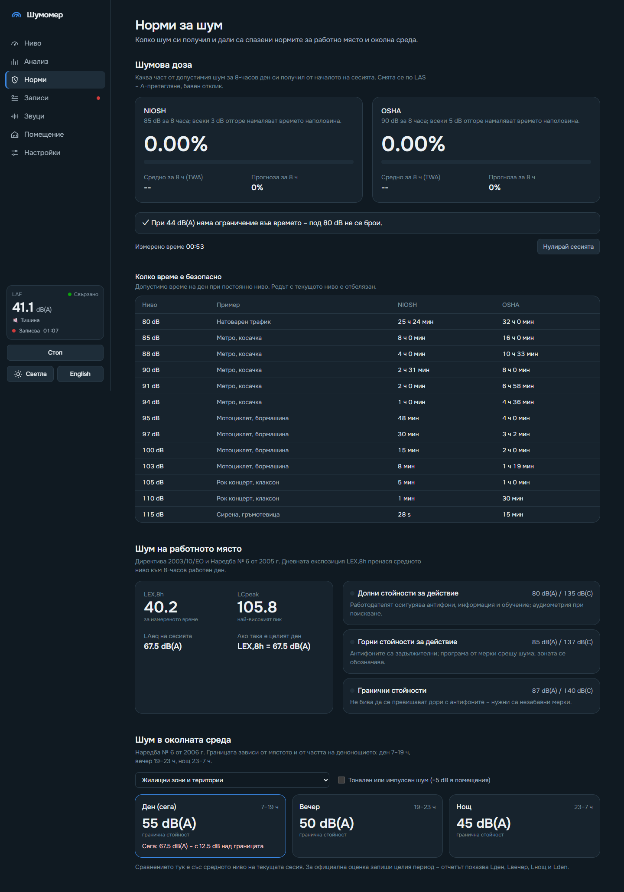
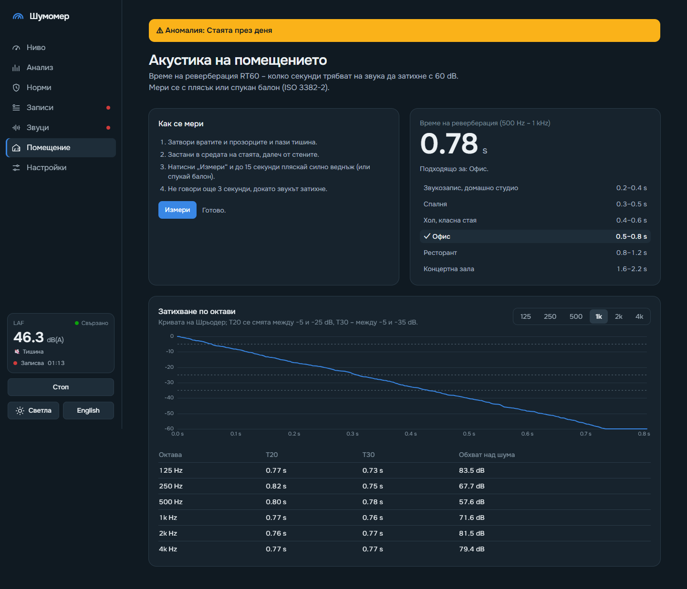
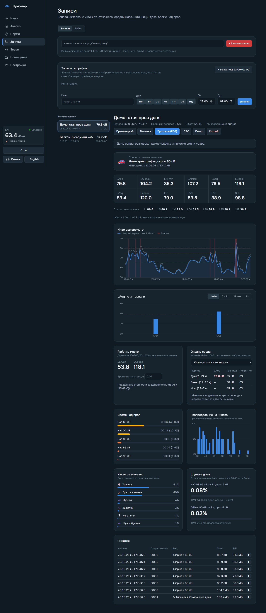
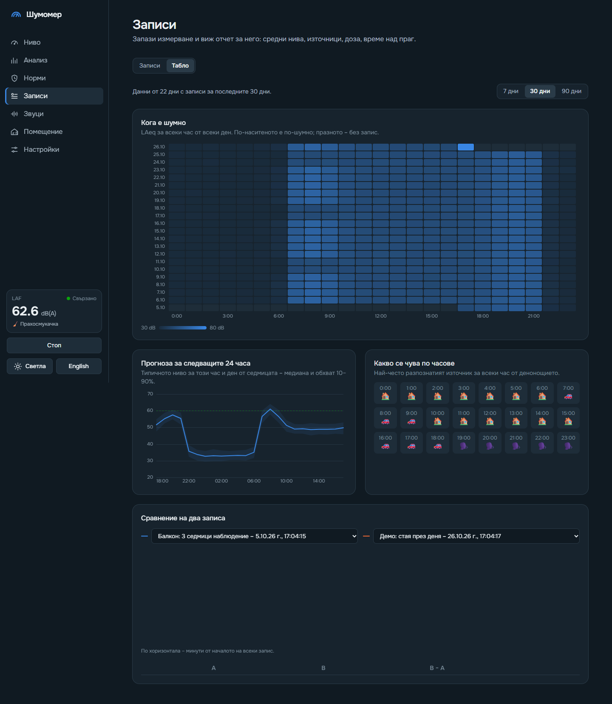
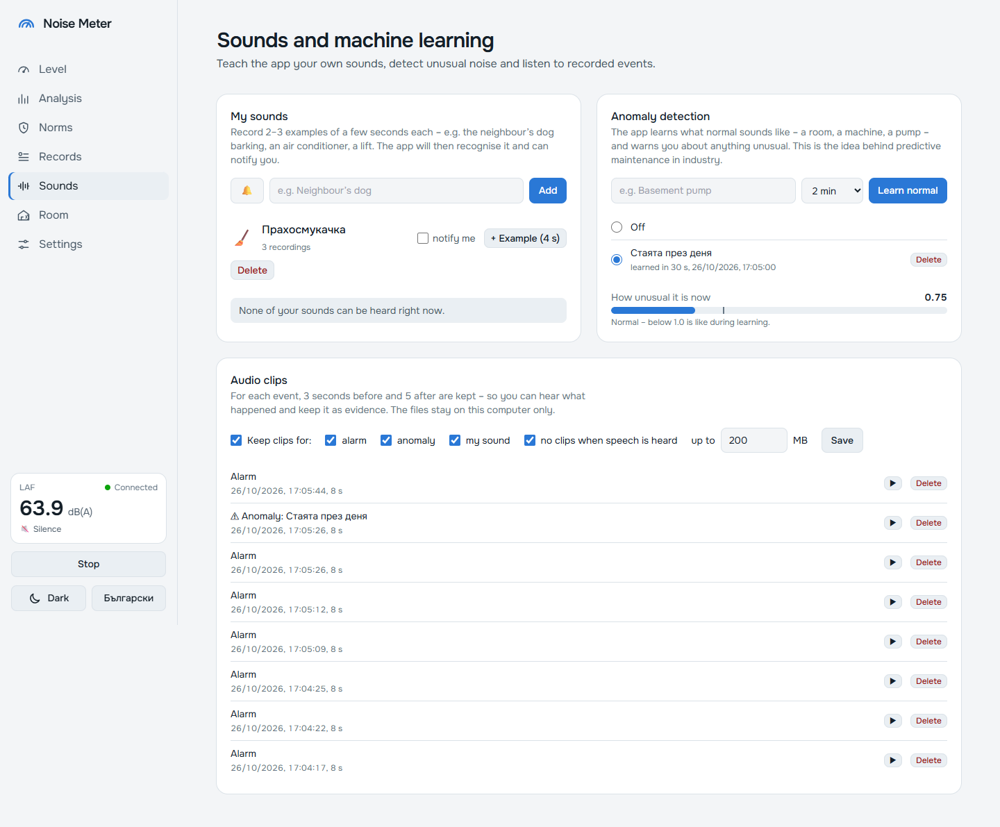
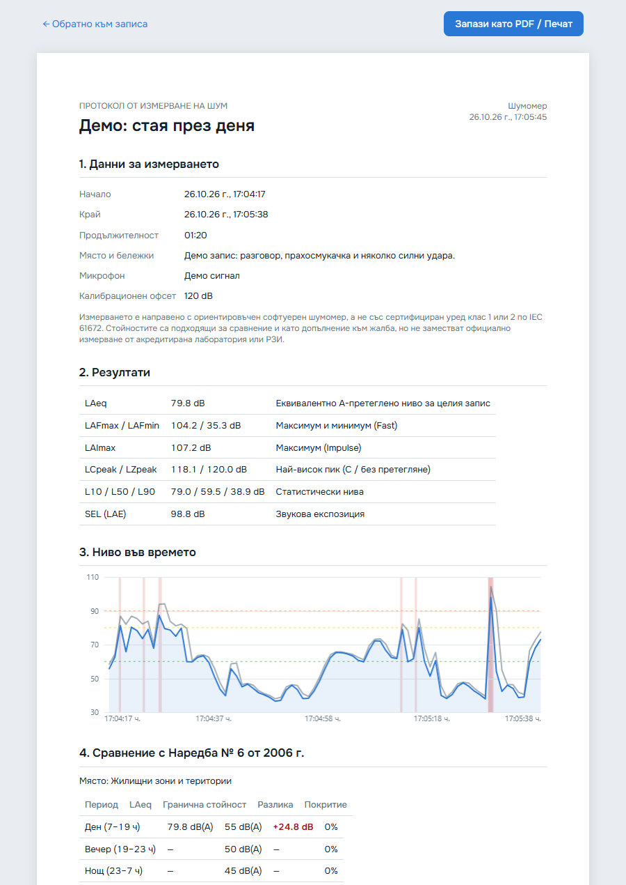
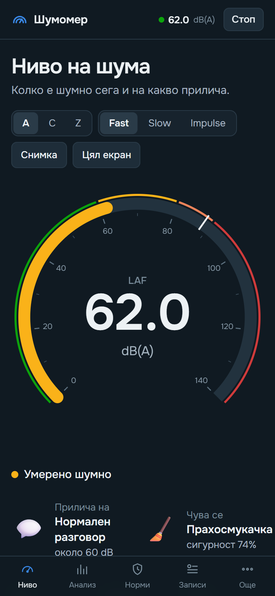
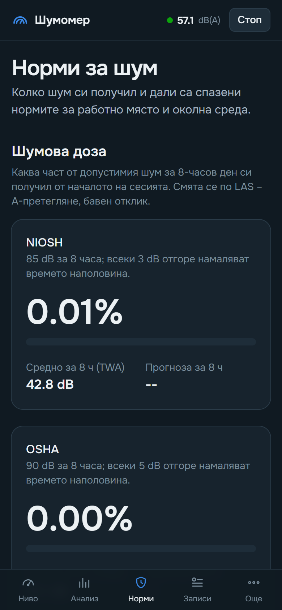
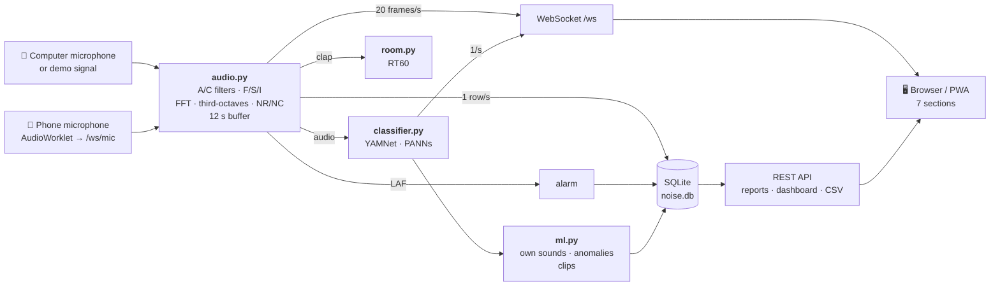

<div align="center">


# Noise Meter

**A sound level meter in the browser, with EU and Bulgarian noise regulations, room acoustics and machine learning.**

A Python backend listens to the computer's microphone (or a phone's), and the interface opens anywhere on
the same network. Useful for a noise complaint about neighbours, workplace noise assessment, room
acoustics or machine monitoring.

[](https://www.python.org/)
[](https://fastapi.tiangolo.com/)
[](https://tailwindcss.com/)
[](https://www.sqlite.org/)
[](https://ai.google.dev/edge/litert)
[](#-phone-and-pwa)
[](LICENSE)

[Български](README.md) · **English**

[Quick start](#quick-start) · [Features](#features) · [Standards](#standards-and-regulations) ·
[Machine learning](#machine-learning) · [Calibration](#calibration) · [How it works](#how-it-works) · [API](#api)

</div>

---

## Screenshots

<table>
  <tr>
    <td width="50%"><br><b>Level</b> – gauge, “sounds like”, live noise scale and what can be heard</td>
    <td width="50%"><br><b>Analysis</b> – sound recognition, spectrum, third-octaves, NR/NC</td>
  </tr>
  <tr>
    <td><br><b>Norms</b> – workplace (LEX,8h), environment (Lden), NIOSH/OSHA dose</td>
    <td><br><b>Room</b> – reverberation time RT60 per ISO 3382-2</td>
  </tr>
  <tr>
    <td><br><b>Records</b> – report with Ln, SEL, interval LAeq, comparison with regulations</td>
    <td><br><b>Dashboard</b> – when it’s loud, 24 h forecast, compare two recordings</td>
  </tr>
  <tr>
    <td><br><b>Sounds</b> – your own sounds, anomaly detection, audio clips</td>
    <td><br><b>Report</b> – A4 for printing or PDF, modelled on ISO 1996-2</td>
  </tr>
</table>

<p align="center">
  
  &nbsp;&nbsp;
  
  <br><sub>On a phone the sections are in a bottom bar, the rest under “More”. It can be installed as an app.</sub>
</p>

## Quick start

Python 3.10 or newer is required.

```bash
git clone https://github.com/Krumqnkata/noise-measure-tool.git
cd noise-measure-tool
python -m venv .venv
```

Activate the environment – on Windows (PowerShell):

```bash
.venv\Scripts\Activate.ps1
```

on Linux / macOS:

```bash
source .venv/bin/activate
```

Install and run:

```bash
pip install -r requirements.txt
python backend/main.py
```

Open **<http://localhost:8000>**. No microphone? Demo mode simulates talking, hum, loud bangs and a
clap for RT60:

```bash
python backend/main.py --demo
```

**Sound recognition and machine learning** are optional – they need one library (Google’s official
TFLite runtime). The YAMNet model (~16 MB) downloads itself into `models/`:

```bash
pip install -r requirements-ml.txt
```

| Flag              | Default        | Description                                               |
|-------------------|----------------|-----------------------------------------------------------|
| `--demo`          | off            | simulated signal instead of a microphone                  |
| `--port`          | `8000`         | port                                                      |
| `--host`          | `0.0.0.0`      | address to listen on                                      |
| `--db`            | `noise.db`     | database file with the recordings                         |
| `--config`        | `config.json`  | settings file                                             |
| `--no-classifier` | on             | no sound recognition                                      |
| `--https`         | off            | https with a self-signed certificate – for a phone’s mic  |

> [!TIP]
> On start the server prints the addresses to open from a phone on the same network. On Windows allow
> Python through the firewall on first run. On Linux you may need PortAudio: `sudo apt install libportaudio2`.

## Features

Seven sections, each with its own address (`/#norms`, `/#records/5`, `/#records/dashboard`…). **Light
and dark theme** (or follow the system), **Bulgarian and English**.

Keys: <kbd>Space</kbd> start/stop · <kbd>1</kbd>–<kbd>7</kbd> section · <kbd>F</kbd> full screen ·
<kbd>R</kbd> reset · <kbd>S</kbd> snapshot · <kbd>T</kbd> theme.

### 🎚️ Level
- 0–140 dB gauge; **A / C / Z** frequency weighting and **Fast / Slow / Impulse** time weighting;
- **“Sounds like”** and a **live noise scale** – 15 familiar sounds from a whisper to a jet engine;
- **“Hearing”** – what the model recognises right now;
- minimum, Leq, maximum, L10 / L50 / L90, peak; last-minute chart; full screen and snapshot.

### 📊 Analysis
- **noise source recognition** – 12 groups: 🗣️ people · 🎵 music · 🐕 dog · 🐾 animals · 🚗 traffic ·
  🔨 construction · 🚨 siren · 🌧️ nature · 🏠 household · 💥 bangs · 〰️ hum · 🔇 silence (plus your own sounds);
- 20 Hz – 20 kHz spectrum, **31 third-octave bands** (IEC 61260), spectrogram, waveform;
- **NR and NC** of background noise in a room – the octave spectrum over the curves.

### 🛡️ Norms
- **Workplace** per Directive 2003/10/EC and Bulgarian Ordinance No. 6/2005: live LEX,8h and LCpeak, a
  traffic light for the lower (80 dB(A) / 135 dB(C)), upper (85 / 137) and limit value (87 / 140) and what each requires;
- **Environment** per Directive 2002/49/EC and Ordinance No. 6/2006: Lday, Levening, Lnight and Lden
  against the limits for the selected type of area or room;
- **NIOSH and OSHA dosimeter**: dose, TWA, 8 h projection and how much longer is safe.

### 🎙️ Records
- every second: LAeq, LAFmax, LAFmin, LAImax, LCeq, LCpeak, LZeq, LZpeak and the recognised source;
- **scheduled** (e.g. every night 23:00–07:00) – plus a **morning sleep report**: Lnight and events
  above 45 dB(A) per the WHO guidelines (2018), with source and clip;
- **report**: L1…L99, SEL, LAeq per 1 / 5 / 15 / 60 min, time above threshold, histogram, sources, dose,
  LEX,8h, comparison with the regulations, low-frequency noise, events with clips;
- **printable report / PDF** (A4) – measurement details, indicators, comparison with limits, signature;
- **dashboard**: day × hour heat map, **forecast for the next 24 h** (median and 10–90 %, from at least
  7 days of data), source by hour, **compare two recordings**; CSV export.

### 🧠 Sounds
- **your own sounds** – record 2–3 examples (“the neighbour’s dog”, a lift) and the app recognises them
  and notifies you;
- **anomaly detection** – learns what “normal” sounds like for a room or a machine and warns about
  unusual sound (the idea behind predictive maintenance);
- **audio clips** – 3 s before and 5 s after each event, optionally no clips with speech, storage limit.

### 🏠 Room
- **RT60 per ISO 3382-2** (engineering method): a clap or a balloon → Schroeder curve, T20 and T30 for the
  125 Hz – 4 kHz octaves, dynamic range check and guidance for bedroom, classroom, office, hall.

### ⚙️ Settings
- the computer’s microphone or **a phone’s**; separate calibration for each (manual, typical or against a
  reference meter);
- **alarm**: threshold, duration, sound, browser notifications and a list of events;
- **recognition model**: fast YAMNet or accurate PANNs CNN14.

### 📱 Phone and PWA
- **the phone’s microphone** – audio is streamed to the server without auto gain or noise suppression, and
  everything else (norms, records, recognition) works as with the computer’s mic;
- browsers only allow the microphone over https – start with `--https` and accept the self-signed
  certificate warning;
- **install as an app** (PWA) – home screen icon, opens in its own window.

## Standards and regulations

| What                          | Document                                    | In the app                                     |
|-------------------------------|---------------------------------------------|------------------------------------------------|
| A/C weighting, Fast/Slow/Impulse, peak | IEC 61672-1                        | `audio.py` – digital filters and detectors     |
| Third-octave bands            | IEC 61260                                   | 31 bands, 20 Hz – 20 kHz                       |
| Workplace noise               | Directive 2003/10/EC, Ordinance No. 6/2005  | LEX,8h, LCpeak, three action values            |
| Noise dose                    | NIOSH REL, OSHA 29 CFR 1910.95              | 85 dB / 3 dB and 90 dB / 5 dB                  |
| Environmental noise           | Directive 2002/49/EC, Ordinance No. 6/2006  | Lday, Levening, Lnight, Lden, limit values     |
| Night noise                   | WHO Environmental Noise Guidelines (2018)   | events above 45 dB(A) in the bedroom           |
| Background noise in rooms     | NR (ISO R1996), NC (ANSI S12.2)             | rating from the octave spectrum                |
| Reverberation                 | ISO 3382-2                                  | T20, T30 per octave                            |
| Measurement report            | ISO 1996-2                                  | printable report / PDF                         |

The limit values of Ordinance No. 6/2006 were checked against the [official text](https://faolex.fao.org/docs/pdf/bul175059.pdf)
and its 2021 amendment (which only renames some of the area types). All numbers live in one place –
[`backend/norms.py`](backend/norms.py), with the source in a comment.

> [!WARNING]
> A laptop or phone microphone is not a certified class 1 or 2 instrument. The results are good as a
> guide and as a supplement to a complaint, but do not replace an official measurement by an accredited lab.

## Machine learning

| Model                 | What it does                                    | Size    | Accuracy (AudioSet mAP) | License                   |
|-----------------------|-------------------------------------------------|---------|-------------------------|---------------------------|
| **YAMNet** (Google)   | recognition every second + embeddings (1024)    | ~16 MB  | ~0.31                   | Apache 2.0                |
| **PANNs CNN14** (Kong et al., 2020) | more accurate recognition every 2 s, optional | ~160 MB | 0.43            | weights CC-BY-4.0, code Apache 2.0 |

- Both models run on the same `ai-edge-litert` library – no PyTorch or TensorFlow. CNN14 is the
  [LiteRT copy from litert-community](https://huggingface.co/litert-community/PANNs-CNN14-AudioSet-LiteRT),
  pinned to a revision and checked with SHA-256 on download.
- **Your own sounds** – each example recording is cut into ~1 s windows and YAMNet’s embedding is kept for
  each. A new sound is compared with the examples by cosine similarity (mean of the three closest); the
  threshold for “unknown” is computed from the examples themselves with leave-one-out.
- **Anomalies** – a profile keeps the embeddings of “normal”. The score is the distance to the closest of
  them divided by the threshold (99.5th percentile during learning × 1.2) – above 1.0 is unusual. An
  unusually loud sound is an anomaly too, even if it sounds normal: more than 6 dB above the 99th
  percentile of the learning level pushes the score over 1.0.
- Events from your own sounds and anomalies go into records, notifications and clips just like alarm events.

## Calibration

A sound card measures relative to its maximum (**dBFS**). To get **dB SPL**, a calibration offset is
added – **120 dB** by default, typical for MEMS microphones in phones and laptops (−26 dBFS at 94 dB SPL).

For more accurate values use **Settings → Using a reference meter**: put a real sound level meter (or a
94 dB calibrator) next to the microphone, play a steady noise, enter its reading and press “Calibrate”.
The offset is kept separately for each microphone – the computer’s and every connected phone.

> [!WARNING]
> Built-in microphones often have automatic gain control, which distorts the result. Turn it off in the
> system’s sound settings if possible.

## How it works



- **A and C weighting** – digital filters from the analogue IEC 61672 curves via the bilinear transform.
- **Fast / Slow / Impulse** – exponential averaging of the squared signal with τ = 125 ms / 1 s; Impulse
  is an asymmetric detector with 35 ms rise and 1.5 s decay.
- **LAeq, Ln, SEL** – from the one-second values; `LAE = LAeq,T + 10·lg(T / 1 s)`.
- **LEX,8h** = `LAeq,Te + 10·lg(Te / 8 h)`; **Lden** = `10·lg((12·10^(Ld/10) + 4·10^((Le+5)/10) + 8·10^((Ln+10)/10)) / 24)`.
- **RT60** – octave filter, Schroeder backward integration, a line through −5…−25 dB (T20) and −5…−35 dB (T30).
- **Recognition** – YAMNet once a second on the last 0.975 s at 16 kHz; CNN14 every ~2 s on the last 2.5 s
  at 32 kHz (repeated to 10 s – the model’s input). Classes are grouped into 12 categories.

### Layout

```
backend/
  main.py        FastAPI: page, API, WebSocket, alarm, recording, schedules, https
  audio.py       capture / demo / phone audio, filters, levels, spectra, NR/NC
  norms.py       regulations and standards: limits, LEX,8h, Lden, NR/NC curves
  room.py        RT60 (ISO 3382-2)
  scheduler.py   scheduled recordings
  classifier.py  recognition (YAMNet) and model choice
  panns.py       the more accurate PANNs CNN14 model
  custom.py      own sounds and anomalies (numpy)
  ml.py          machine learning events and audio clips
  db.py          SQLite with migrations: recordings, measurements, events, reports, dashboard
  certs.py       self-signed certificate for --https
static/
  index.html     the shell and seven sections, colours of both themes
  common.js      formatting, chart helpers, errors
  i18n.js        translations (the key is the Bulgarian text)
  meter.js · norms.js · analysis.js · records.js · dashboard.js · room.js · sounds.js
  mic.js         the phone microphone (AudioWorklet)
  report.html    the printable report / PDF
  sw.js · manifest.webmanifest · icons/   PWA
tests/           pytest – formulas, regulations, RT60, database, machine learning
scripts/
  screenshots.py the screenshots in docs/screenshots
  make_icons.py  PWA icons
```

Tests and screenshots:

```bash
pip install -r requirements-dev.txt
python -m pytest
python scripts/screenshots.py
```

## API

| Path                                  | Method          | Description                                                    |
|---------------------------------------|-----------------|----------------------------------------------------------------|
| `/ws`                                 | WS              | `data` (~20/s), `sound` (~1/s), `status`, `alarm`, `ml_event`, `clip`, `schedule_done` |
| `/ws/mic`                             | WS              | audio from the browser (PCM float32) – the phone’s microphone   |
| `/api/status`                         | GET             | state: measuring, source, offset, alarm, model                  |
| `/api/devices`, `/api/device`         | GET, POST       | input devices / select `{"index": 3}`                           |
| `/api/calibration`                    | POST            | `{"offset": 92.5}` – for the current source                     |
| `/api/start`, `/api/stop`             | POST            | start / stop measuring                                          |
| `/api/alarm`                          | POST            | `{"enabled": true, "threshold": 85, "duration": 3}`             |
| `/api/events?limit=20`                | GET             | events: alarm, own sound, anomaly (with `clip_id`)              |
| `/api/norms`                          | GET             | the regulation tables (one place for the numbers)               |
| `/api/room/rt60`                      | POST            | waits for a clap and returns RT60 per octave                    |
| `/api/recording/start`, `/stop`       | POST            | `{"name": "Bedroom, night"}`                                    |
| `/api/schedules`                      | GET, POST       | schedules; `PUT`, `DELETE /api/schedules/{id}`                  |
| `/api/sessions`                       | GET             | all recordings                                                  |
| `/api/sessions/{id}`                  | GET, PATCH, DELETE | report / name and note / delete                              |
| `/api/sessions/{id}/csv`              | GET             | measurements as CSV                                             |
| `/report/{id}`                        | GET             | printable report / PDF                                          |
| `/api/dashboard?days=30`              | GET             | heat map, forecast, sources by hour                             |
| `/api/custom-sounds`                  | GET, POST       | own sounds; `PATCH`, `DELETE /api/custom-sounds/{id}`            |
| `/api/custom-sounds/{id}/examples`    | POST, DELETE    | `{"seconds": 4}` – record an example / delete the examples      |
| `/api/anomaly`                        | GET             | profiles and the active one                                     |
| `/api/anomaly/learn`                  | POST            | `{"name": "Pump", "minutes": 2}`                                |
| `/api/anomaly/active`                 | POST            | `{"id": 3}` or `{"id": null}`; `DELETE /api/anomaly/{id}`        |
| `/api/clips`, `/api/clips/{id}`       | GET, DELETE     | list / WAV file / delete                                        |
| `/api/clips/settings`                 | POST            | `{"enabled", "on", "skip_speech", "max_mb"}`                     |
| `/api/classifier/model`               | POST            | `{"model": "yamnet"}` or `{"model": "panns"}`                   |

Errors come as a code (`{"detail": {"code": "not_found"}}`) and the interface translates them.

## Ideas for the future

- [x] the phone’s microphone and installing as an app (PWA)
- [x] scheduled recordings with a sleep report
- [x] source recognition, own sounds, anomaly detection
- [x] comparing two recordings and a PDF report
- [ ] Telegram or Discord notifications on alarm
- [ ] several microphones at once (e.g. room and street) and the difference between them
- [ ] a noise map from measurements in different places

## License

[MIT](LICENSE) © 2026 Krumqnkata

The models are not part of the repository; they download into `models/` when needed:
- **YAMNet** – Google, [Apache 2.0](https://www.kaggle.com/models/google/yamnet);
- **PANNs CNN14** – Q. Kong et al., *PANNs: Large-Scale Pretrained Audio Neural Networks for Audio
  Pattern Recognition*, 2020; weights [CC-BY-4.0 (Zenodo 3987831)](https://zenodo.org/records/3987831),
  LiteRT conversion by [litert-community](https://huggingface.co/litert-community/PANNs-CNN14-AudioSet-LiteRT).
