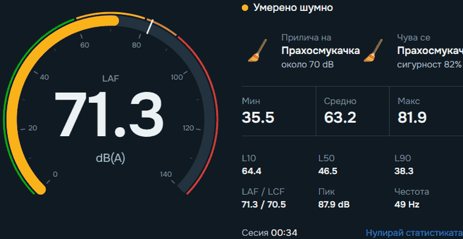
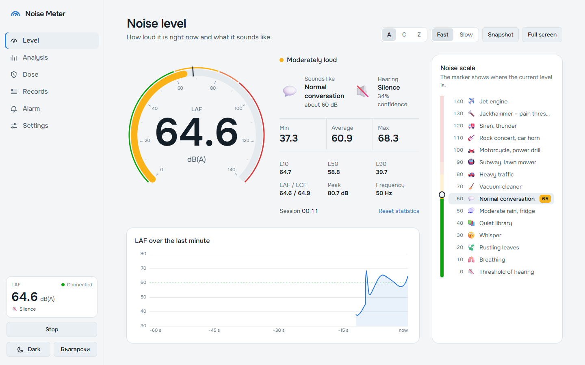
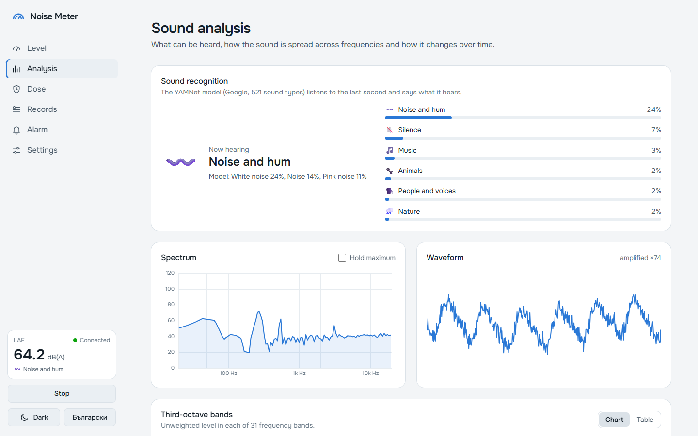
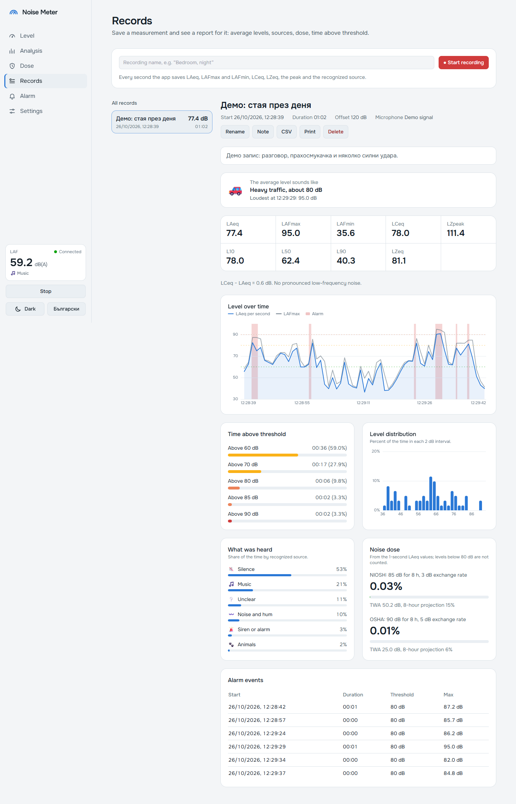
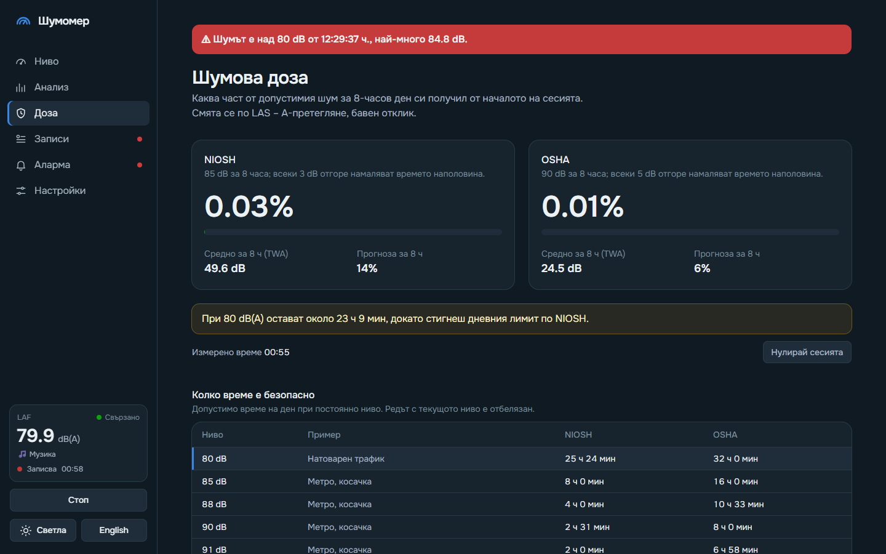

<div align="center">



# Noise Meter

**Real-time noise measurement in the browser – with a dial, sound source recognition, spectrum, noise dose and recordings.**

A Python backend listens to the microphone; the interface opens on the computer or on a phone on the same network.

[](https://www.python.org/)
[](https://fastapi.tiangolo.com/)
[](https://tailwindcss.com/)
[](https://www.sqlite.org/)
[](https://www.kaggle.com/models/google/yamnet)
[](LICENSE)

[Български](README.md) · **English**

</div>

---

<table>
  <tr>
    <td width="50%"><br><b>Level</b> – dial, “sounds like”, what is being heard and a live noise scale</td>
    <td width="50%"><br><b>Analysis</b> – sound recognition, spectrum, third-octave bands, spectrogram</td>
  </tr>
  <tr>
    <td><br><b>Records</b> – report with L10/L50/L90, sources, time above threshold, dose and CSV</td>
    <td><br><b>Dose</b> – NIOSH and OSHA dosimeter (dark theme, Bulgarian UI)</td>
  </tr>
</table>

## Quick start

Requires Python 3.10 or newer.

```bash
git clone https://github.com/Krumqnkata/noise-measure-tool.git
cd noise-measure-tool
python -m venv .venv
```

Activate it – Windows (PowerShell): `.venv\Scripts\Activate.ps1`, Linux / macOS: `source .venv/bin/activate`. Then:

```bash
pip install -r requirements.txt
python backend/main.py
```

Open **<http://localhost:8000>** and switch the language to English in the bottom-left corner or in Settings.
No microphone? Run the demo with a simulated signal:

```bash
python backend/main.py --demo
```

Sound source recognition is optional. It needs Google’s official TFLite runtime; the model (~4 MB) downloads itself
into `models/` on first start:

```bash
pip install -r requirements-ml.txt
```

> [!NOTE]
> Sound is always captured by the microphone of the computer running the server – a phone only displays the data.
> On Linux you may need PortAudio: `sudo apt install libportaudio2`.

## Features

- **Level** – 0–140 dB dial, A / C / Z frequency weighting and Fast / Slow time weighting, “sounds like” with a live
  scale of 15 familiar sounds, the currently recognized source, min / average / max, L10 / L50 / L90, full screen and
  PNG snapshots.
- **Analysis** – recognition with Google’s **YAMNet** (521 AudioSet classes grouped into 12 categories: people, music,
  dog, animals, traffic, construction and tools, sirens, nature, household, bangs, hum, silence), spectrum with
  max hold, 31 third-octave bands (chart or table), spectrogram and waveform.
- **Dose** – NIOSH and OSHA noise dose, TWA, 8-hour projection and how much time is still safe.
- **Records** – every second is stored in SQLite; reports with statistics, sources heard, alarm events, dose, notes,
  CSV export and printing.
- **Alarm** – threshold and minimum duration, banner, sound and browser notification; every exceedance is logged.
- **Settings** – light / dark / system theme, Bulgarian / English, microphone, calibration (manual, typical offset, or
  against a reference meter).

The sound card measures relative to its own maximum (dBFS), so an offset turns readings into dB SPL. The default is
**120 dB**, typical for the MEMS microphones in phones and laptops; calibrate against a real meter for better accuracy.
This is an indicative tool, not a certified sound level meter.

See the [Bulgarian README](README.md) for the full details: how the levels are computed, the project structure and the API.

## License

[MIT](LICENSE) © 2026 Krumqnkata. The YAMNet model belongs to Google and is distributed under Apache 2.0; it is not part
of this repository and is downloaded on first start.
