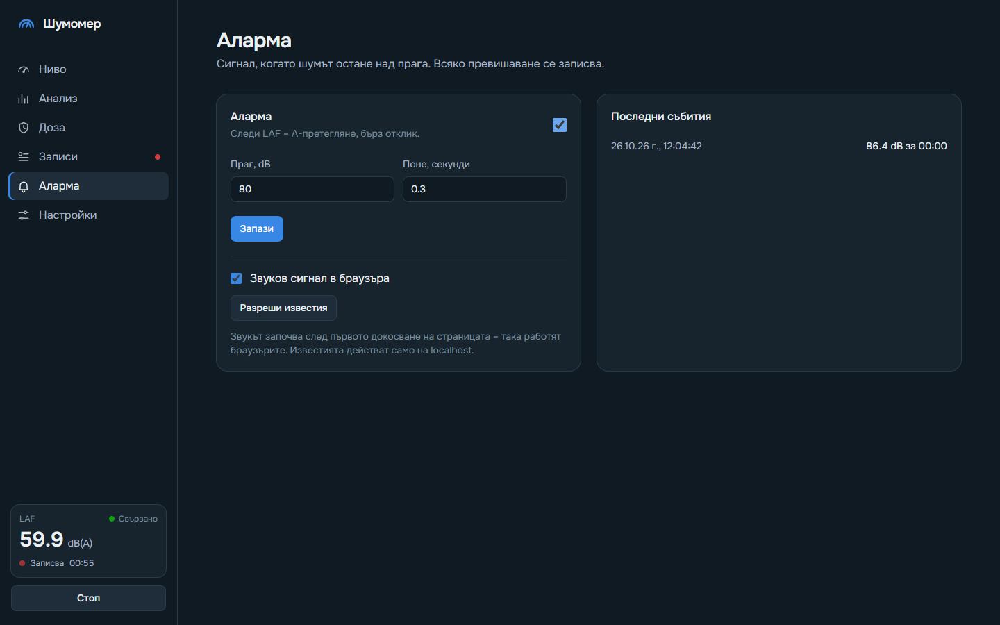
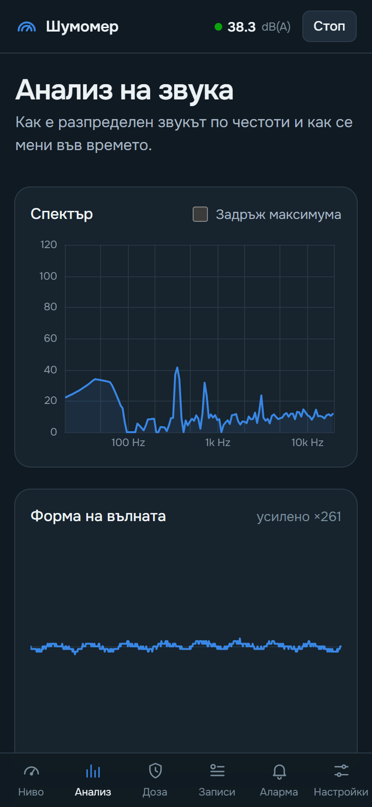
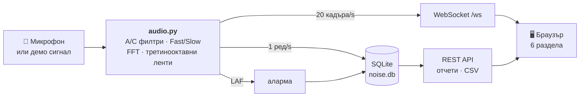

<div align="center">


# Шумомер

**Измерване на шум в реално време в браузъра – с циферблат, спектър, шумова доза и записи.**

Python бекенд слуша микрофона, а интерфейсът се отваря на компютъра или на телефона в същата мрежа.

[](https://www.python.org/)
[](https://fastapi.tiangolo.com/)
[](https://tailwindcss.com/)
[](https://www.sqlite.org/)
[](LICENSE)

[Бърз старт](#бърз-старт) · [Възможности](#възможности) · [Калибриране](#калибриране) · [Как работи](#как-работи) · [API](#api)

</div>

---

## Снимки

<table>
  <tr>
    <td width="50%"><br><b>Ниво</b> – циферблат, „прилича на“ и жива скала на шума</td>
    <td width="50%"><br><b>Анализ</b> – спектър, третинооктавни ленти, спектрограма</td>
  </tr>
  <tr>
    <td><br><b>Доза</b> – колко от дневния лимит по NIOSH и OSHA е изразходван</td>
    <td><br><b>Записи</b> – отчет с L10/L50/L90, време над праг, доза и CSV</td>
  </tr>
  <tr>
    <td><br><b>Аларма</b> – праг, звук, известия и списък със събития</td>
    <td><br><b>Настройки</b> – микрофон и калибриране по еталон</td>
  </tr>
</table>

<p align="center">
  
  &nbsp;&nbsp;
  
  <br><sub>На телефон разделите са в долна лента – като в мобилно приложение.</sub>
</p>

## Бърз старт

Нужен е Python 3.10 или по-нов.

```bash
git clone https://github.com/Krumqnkata/noise-measure-tool.git
cd noise-measure-tool
python -m venv .venv
```

Активирай средата – на Windows (PowerShell):

```bash
.venv\Scripts\Activate.ps1
```

на Linux / macOS:

```bash
source .venv/bin/activate
```

Инсталирай и пусни:

```bash
pip install -r requirements.txt
python backend/main.py
```

Отвори **<http://localhost:8000>**. Няма микрофон? Пусни демо режима – симулиран сигнал с разговор, бучене и силни удари:

```bash
python backend/main.py --demo
```

> [!TIP]
> Сървърът слуша на `0.0.0.0:8000`, така че от телефон в същата мрежа може да се отвори
> `http://<IP-на-компютъра>:8000`. На Windows разреши Python в защитната стена при първото стартиране.

> [!NOTE]
> Звукът винаги се записва от микрофона на компютъра, на който върви сървърът – телефонът само показва
> данните. На Linux може да е нужна библиотеката PortAudio: `sudo apt install libportaudio2`.

| Флаг       | По подразбиране | Описание                           |
|------------|-----------------|------------------------------------|
| `--demo`   | изключен        | симулиран сигнал вместо микрофон   |
| `--port`   | `8000`          | порт                               |
| `--host`   | `0.0.0.0`       | адрес, на който да слуша           |
| `--db`     | `noise.db`      | файл на базата със записите        |
| `--config` | `config.json`   | файл с настройките                 |

## Възможности

Приложението има шест раздела. Всеки има свой адрес (`/#analysis`, `/#records/5`…), така че може да
се отвори директно. Клавиши: <kbd>Интервал</kbd> старт/стоп · <kbd>1</kbd>–<kbd>6</kbd> раздел ·
<kbd>F</kbd> цял екран · <kbd>R</kbd> нулиране · <kbd>S</kbd> снимка.

### 🎚️ Ниво
- циферблат 0–140 dB с цветни зони и отметка за максимума;
- честотно претегляне **A / C / Z** и времево **Fast / Slow**;
- **„Прилича на“** и **жива скала на шума** – 15 познати звука от шепот до реактивен двигател;
  маркерът се движи по скалата и осветява най-близкия;
- минимум, средно (Leq), максимум, L10 / L50 / L90, пик и пикова честота;
- графика на последната минута; **цял екран** и **снимка** (PNG за споделяне).

### 📊 Анализ
- спектър 20 Hz – 20 kHz със задържане на максимума;
- **третинооктавни ленти** (31 ленти по IEC 61260) – като графика или таблица;
- спектрограма за последните ~30 секунди и форма на вълната;
- подсказки с точните стойности при посочване с мишката.

### 🛡️ Доза
- **дозиметър по NIOSH и OSHA**: доза в %, TWA, прогноза за 8 часа;
- колко още е безопасно при текущото ниво;
- таблица с допустимото време при различни нива.

### 🎙️ Записи
- всяка секунда се пазят LAeq, LAFmax, LAFmin, LCeq, LZeq и LZpeak в SQLite;
- отчет: статистически нива, време над 60/70/80/85/90 dB, хистограма, графика със събитията от
  алармата, шумова доза, кога е бил най-шумният момент, проверка за нискочестотен шум;
- бележки, **CSV експорт**, печат, преименуване, изтриване.

### 🔔 Аларма
- праг и минимална продължителност;
- червен банер, звуков сигнал и известие в браузъра; всяко превишаване се пази като събитие.

### ⚙️ Настройки
- избор на микрофон;
- калибриране на ръка, с типичния офсет или **по еталонен шумомер**.

## Калибриране

Звуковата карта мери спрямо своя максимум (**dBFS**) – там 0 е най-силното, а всичко останало е
отрицателно. За да станат **dB SPL** (това, което показват шумомерите), се добавя калибрационен офсет.
По подразбиране той е **120 dB** – типичната стойност за MEMS микрофоните в телефони и лаптопи
(−26 dBFS при 94 dB SPL). Така работят и мобилните приложения: имат готов офсет за всеки модел.

За по-точни стойности в **Настройки → По еталонен шумомер**:

1. Сложи истински шумомер (или калибратор 94 dB) до микрофона и пусни постоянен шум.
2. Въведи какво показва той и натисни „Калибрирай“ – офсетът се изчислява от последните 3 секунди.

Офсетът, микрофонът и алармата се пазят в `config.json`; всеки запис помни офсета, с който е направен.

> [!WARNING]
> Вградените в лаптопи микрофони често имат автоматично усилване, което изкривява резултата. Ако е
> възможно, изключи го от звуковите настройки на системата. Приложението е ориентировъчен уред и не
> замества сертифициран шумомер.

## Как работи



- **A- и C-претегляне** – цифрови филтри от аналоговите криви по IEC 61672 чрез билинейна
  трансформация. Под 4 kHz съвпадат с кривите; над 10 kHz отклонението е в толерансите за клас 1.
- **Fast / Slow** – експоненциално усредняване на квадрата на сигнала с τ = 125 ms / 1 s.
- **LAeq (1 s)** – енергийно средно за всяка секунда; LAeq на целия запис е енергийно средно на тях.
  L10 / L50 / L90 се смятат от едносекундните стойности.
- **Третинооктавни ленти** – от FFT с 8192 точки; мощността се интегрира между границите на лентата,
  затова и тесните ниски ленти дават правилна енергия.
- **Шумова доза** – при ниво L допустимото време е `8 ч / 2^((L − критерий) / обменен коефициент)`:
  NIOSH 85 dB / 3 dB, OSHA 90 dB / 5 dB; нивата под 80 dB не се броят.

### Структура

```
backend/
  main.py      FastAPI: страница, API, WebSocket, аларма, записи
  audio.py     запис / демо сигнал, филтри, нива, спектри
  db.py        SQLite: записи, измервания, събития, отчети, доза
static/
  index.html   обвивката и шестте раздела (Tailwind CSS през CDN)
  common.js    цветове, форматиране, помощни функции за графиките
  state.js     общото състояние
  meter.js     „Ниво“ и „Доза“
  analysis.js  „Анализ“
  records.js   „Записи“
  app.js       навигация, връзка със сървъра, аларма, настройки
scripts/
  screenshots.py   прави снимките в docs/screenshots
```

Снимките в този файл се правят автоматично в демо режим – с отделни временни настройки и база:

```bash
pip install -r requirements-dev.txt
python scripts/screenshots.py
```

## API

| Път                          | Метод  | Описание                                                  |
|------------------------------|--------|-----------------------------------------------------------|
| `/ws`                        | WS     | съобщения `data` (~20/s), `status`, `alarm`               |
| `/api/status`                | GET    | състояние: запис, микрофон, офсет, аларма                 |
| `/api/devices`               | GET    | входни устройства                                         |
| `/api/device`                | POST   | `{"index": 3}` или `{"index": null}` за системното        |
| `/api/calibration`           | POST   | `{"offset": 92.5}`                                        |
| `/api/start`, `/api/stop`    | POST   | старт / стоп на измерването                               |
| `/api/alarm`                 | POST   | `{"enabled": true, "threshold": 85, "duration": 3}`       |
| `/api/events?limit=20`       | GET    | последни събития от алармата                              |
| `/api/recording/start`       | POST   | `{"name": "Спалня, нощ"}` – започва запис                 |
| `/api/recording/stop`        | POST   | спира записа                                              |
| `/api/sessions`              | GET    | всички записи                                             |
| `/api/sessions/{id}`         | GET    | отчет за запис                                            |
| `/api/sessions/{id}`         | PATCH  | `{"name": "...", "note": "..."}` – име и/или бележка      |
| `/api/sessions/{id}`         | DELETE | изтриване                                                 |
| `/api/sessions/{id}/csv`     | GET    | измерванията като CSV                                     |

Съобщението `data` съдържа `db`, `dba`, `dbc` (Fast), `levels` (всички комбинации A/C/Z × F/S),
`peak_db`, `peak_freq`, `waveform[512]`, `spectrum[128]` и `octaves[31]`.

## Идеи за бъдещето

- [ ] измерване с микрофона на телефона (Web Audio), не само на компютъра
- [ ] инсталиране като приложение на телефона (PWA)
- [ ] записи по график – например всяка нощ от 23:00 до 7:00, с отчет за съня
- [ ] разпознаване на източника – трафик, музика, лай, ремонт
- [ ] известия в Telegram или Discord при аларма
- [ ] сравнение на два записа и PDF отчет
- [ ] светла тема и английски език

## Лиценз

[MIT](LICENSE) © 2026 Krumqnkata
