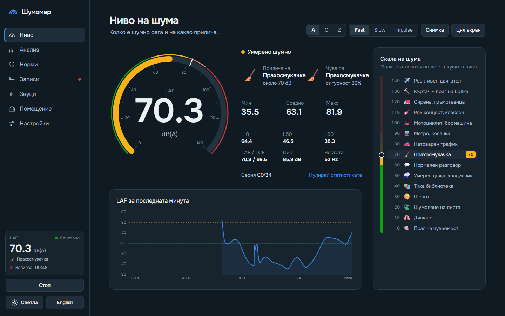
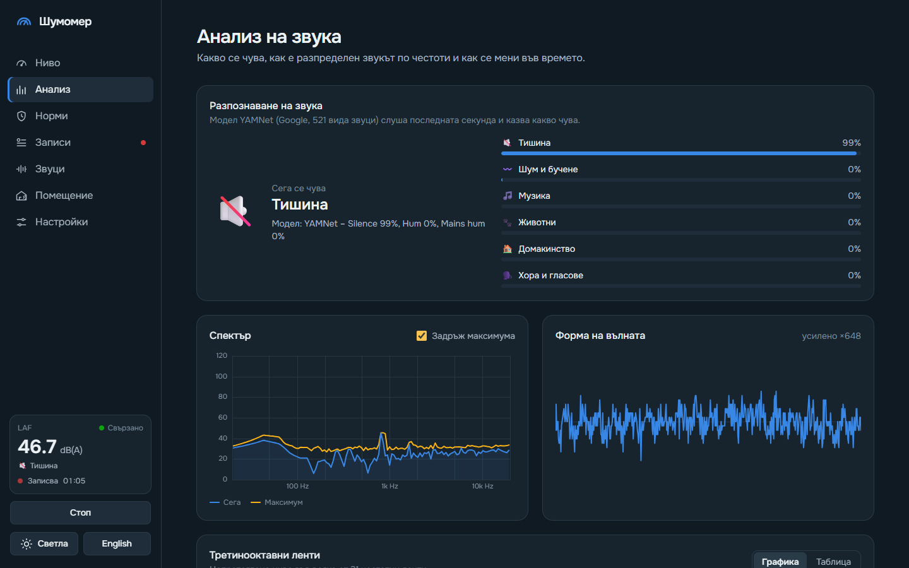
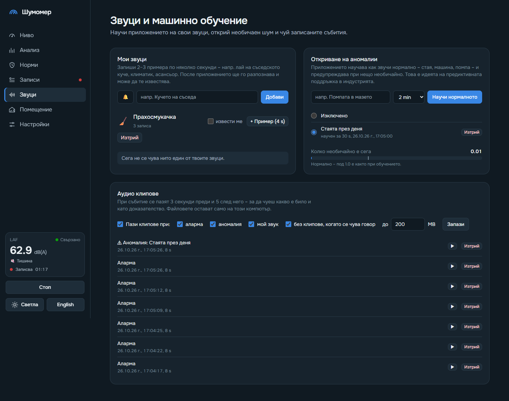
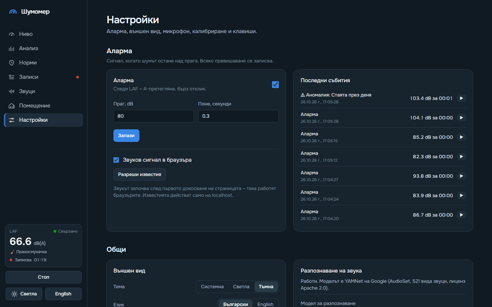
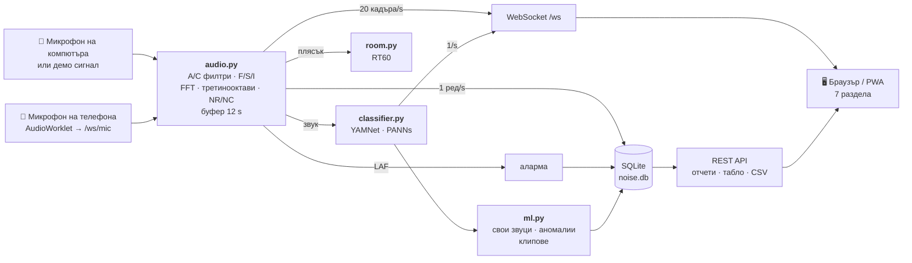

<div align="center">


# Шумомер

**Шумомер в браузъра с нормите на ЕС и България, акустика на помещения и машинно обучение.**

Python бекенд слуша микрофона на компютъра (или на телефона), а интерфейсът се отваря навсякъде в
същата мрежа. Подходящ за жалба за шум от съседи, оценка на шума на работното място, акустика на
стая или наблюдение на машина.

[](https://www.python.org/)
[](https://fastapi.tiangolo.com/)
[](https://tailwindcss.com/)
[](https://www.sqlite.org/)
[](https://ai.google.dev/edge/litert)
[](#-телефон-и-pwa)
[](LICENSE)

**Български** · [English](README.en.md)

[Бърз старт](#бърз-старт) · [Възможности](#възможности) · [Стандарти](#стандарти-и-норми) ·
[Машинно обучение](#машинно-обучение) · [Калибриране](#калибриране) · [Как работи](#как-работи) · [API](#api)

</div>

---

## Снимки

<table>
  <tr>
    <td width="50%"><br><b>Ниво</b> – циферблат, „прилича на“, жива скала на шума и какво се чува</td>
    <td width="50%"><br><b>Анализ</b> – спектър, третинооктави, NR/NC, спектрограма</td>
  </tr>
  <tr>
    <td><br><b>Норми</b> – работно място (LEX,8h), околна среда (Lden), NIOSH/OSHA доза</td>
    <td><br><b>Помещение</b> – време на реверберация RT60 по ISO 3382-2</td>
  </tr>
  <tr>
    <td><br><b>Записи</b> – отчет с Ln, SEL, LAeq по интервали, сравнение с наредбите</td>
    <td><br><b>Табло</b> – кога е шумно, прогноза за 24 ч, сравнение на два записа</td>
  </tr>
  <tr>
    <td><br><b>Звуци</b> – свои звуци, откриване на аномалии, аудио клипове</td>
    <td><br><b>Протокол</b> – A4 за печат или PDF, по образец на ISO 1996-2</td>
  </tr>
  <tr>
    <td><br><b>Светла тема</b> и <b>английски език</b> – с един клик</td>
    <td><br><b>Настройки</b> – микрофон, калибриране, аларма, модел за разпознаване</td>
  </tr>
</table>

<p align="center">
  
  &nbsp;&nbsp;
  
  <br><sub>На телефон разделите са в долна лента, останалите – под „Още“. Може да се инсталира като приложение.</sub>
</p>

## Бърз старт

Нужен е Python 3.10 или по-нов.

```bash
git clone https://github.com/Krumqnkata/noise-measure-tool.git
cd noise-measure-tool
python -m venv .venv
```

Активирай средата – на Windows (PowerShell):

```bash
.venv\Scripts\Activate.ps1
```

на Linux / macOS:

```bash
source .venv/bin/activate
```

Инсталирай и пусни:

```bash
pip install -r requirements.txt
python backend/main.py
```

Отвори **<http://localhost:8000>**. Няма микрофон? Демо режимът симулира разговор, бучене, силни удари
и плясък за RT60:

```bash
python backend/main.py --demo
```

**Разпознаването на звуци и машинното обучение** са по желание – нужна им е една библиотека
(официалният TFLite runtime на Google). Моделът YAMNet (~16 MB) се сваля сам в папка `models/`:

```bash
pip install -r requirements-ml.txt
```

| Флаг              | По подразбиране | Описание                                                    |
|-------------------|-----------------|-------------------------------------------------------------|
| `--demo`          | изключен        | симулиран сигнал вместо микрофон                            |
| `--port`          | `8000`          | порт                                                        |
| `--host`          | `0.0.0.0`       | адрес, на който да слуша                                    |
| `--db`            | `noise.db`      | файл на базата със записите                                 |
| `--config`        | `config.json`   | файл с настройките                                          |
| `--no-classifier` | включено        | без разпознаване на звуци                                   |
| `--https`         | изключен        | https със самоподписан сертификат – за микрофона на телефона |

> [!TIP]
> При стартиране сървърът изписва адресите, на които се отваря от телефон в същата мрежа. На Windows
> разреши Python в защитната стена при първото стартиране. На Linux може да е нужна PortAudio:
> `sudo apt install libportaudio2`.

## Възможности

Седем раздела, всеки със свой адрес (`/#norms`, `/#records/5`, `/#records/dashboard`…). **Светла и
тъмна тема** (или според системата), **български и английски език**.

Клавиши: <kbd>Интервал</kbd> старт/стоп · <kbd>1</kbd>–<kbd>7</kbd> раздел · <kbd>F</kbd> цял екран ·
<kbd>R</kbd> нулиране · <kbd>S</kbd> снимка · <kbd>T</kbd> тема.

### 🎚️ Ниво
- циферблат 0–140 dB; честотно претегляне **A / C / Z** и времево **Fast / Slow / Impulse**;
- **„Прилича на“** и **жива скала на шума** – 15 познати звука от шепот до реактивен двигател;
- **„Чува се“** – какво разпознава моделът в момента;
- минимум, Leq, максимум, L10 / L50 / L90, пик; графика на последната минута; цял екран и снимка.

### 📊 Анализ
- **разпознаване на източника** – 12 групи: 🗣️ хора · 🎵 музика · 🐕 куче · 🐾 животни · 🚗 трафик ·
  🔨 ремонт · 🚨 сирена · 🌧️ природа · 🏠 домакинство · 💥 удари · 〰️ бучене · 🔇 тишина (плюс твоите звуци);
- спектър 20 Hz – 20 kHz, **31 третинооктавни ленти** (IEC 61260), спектрограма, форма на вълната;
- **NR и NC** на фоновия шум в помещение – октавният спектър върху кривите.

### 🛡️ Норми
- **Работно място** по Директива 2003/10/ЕО и Наредба № 6/2005: LEX,8h и LCpeak на живо, „светофар“
  за долна (80 dB(A) / 135 dB(C)), горна (85 / 137) и гранична стойност (87 / 140) и какво изисква всяка;
- **Околна среда** по Директива 2002/49/ЕО и Наредба № 6/2006: Lден, Lвечер, Lнощ и Lden спрямо
  граничните стойности за избрания вид територия или помещение;
- **дозиметър по NIOSH и OSHA**: доза, TWA, прогноза за 8 ч и колко още е безопасно.

### 🎙️ Записи
- всяка секунда: LAeq, LAFmax, LAFmin, LAImax, LCeq, LCpeak, LZeq, LZpeak и разпознатият източник;
- **по график** (напр. всяка нощ 23:00–07:00) – и **сутрешен отчет за съня**: Lнощ и събитията над
  45 dB(A) по насоките на СЗО (2018), с източник и клип;
- **отчет**: L1…L99, SEL, LAeq за 1 / 5 / 15 / 60 мин, време над праг, хистограма, източници, доза,
  LEX,8h, сравнение с наредбите, нискочестотен шум, събития с клипове;
- **протокол за печат / PDF** (A4) – данни за измерването, показатели, сравнение с нормите, подпис;
- **табло**: топлинна карта ден × час, **прогноза за следващите 24 ч** (медиана и 10–90 %, от поне
  7 дни данни), източник по час, **сравнение на два записа**; CSV експорт.

### 🧠 Звуци
- **свои звуци** – запиши 2–3 примера („кучето на съседа“, асансьор) и приложението ги разпознава и
  известява;
- **откриване на аномалии** – научава „нормалното“ за стая или машина и предупреждава при необичаен
  звук (идеята на предиктивната поддръжка);
- **аудио клипове** – 3 s преди и 5 s след всяко събитие, по желание без клипове с говор, лимит на мястото.

### 🏠 Помещение
- **RT60 по ISO 3382-2** (инженерен метод): плясък или балон → крива на Шрьодер, T20 и T30 по октави
  125 Hz – 4 kHz, проверка на обхвата над шума и ориентир за спалня, клас, офис, зала.

### ⚙️ Настройки
- микрофон на компютъра или **на телефона**; калибриране за всеки поотделно (ръчно, типично или по
  еталонен шумомер);
- **аларма**: праг, продължителност, звук, известия в браузъра и списък със събития;
- **модел за разпознаване**: бърз YAMNet или точен PANNs CNN14.

### 📱 Телефон и PWA
- **микрофонът на телефона** – звукът се изпраща към сървъра без автоматично усилване и потискане на
  шума, и всичко останало (норми, записи, разпознаване) работи както с компютърния;
- браузърите дават микрофона само по https – пусни с `--https` и приеми предупреждението за
  самоподписания сертификат;
- **инсталиране като приложение** (PWA) – икона на началния екран, отваря се в собствен прозорец.

## Стандарти и норми

| Какво                         | Документ                                    | В приложението                                  |
|-------------------------------|---------------------------------------------|-------------------------------------------------|
| Претегляне A/C, Fast/Slow/Impulse, пик | IEC 61672-1                        | `audio.py` – цифрови филтри и детектори         |
| Третинооктавни ленти          | IEC 61260                                   | 31 ленти, 20 Hz – 20 kHz                        |
| Шум на работното място        | Директива 2003/10/ЕО, Наредба № 6/2005      | LEX,8h, LCpeak, три прага                       |
| Шумова доза                   | NIOSH REL, OSHA 29 CFR 1910.95              | 85 dB / 3 dB и 90 dB / 5 dB                     |
| Шум в околната среда          | Директива 2002/49/ЕО, Наредба № 6/2006      | Lден, Lвечер, Lнощ, Lden, гранични стойности    |
| Нощен шум                     | WHO Environmental Noise Guidelines (2018)   | събития над 45 dB(A) в спалнята                 |
| Фонов шум в помещения         | NR (ISO R1996), NC (ANSI S12.2)             | рейтинг от октавния спектър                     |
| Реверберация                  | ISO 3382-2                                  | T20, T30 по октави                              |
| Доклад от измерване           | ISO 1996-2                                  | протокол за печат / PDF                         |

Граничните стойности на Наредба № 6/2006 са сверени с [официалния текст](https://faolex.fao.org/docs/pdf/bul175059.pdf)
и изменението от 2021 г. (то сменя само имената на част от териториите). Всички числа са на едно
място – [`backend/norms.py`](backend/norms.py), с източника в коментар.

> [!WARNING]
> Микрофонът на лаптоп или телефон не е сертифициран уред клас 1 или 2. Резултатите са добри за
> ориентир и като допълнение към жалба, но не заместват официално измерване от акредитирана лаборатория.

## Машинно обучение

| Модел                 | Какво прави                                     | Размер  | Точност (AudioSet mAP) | Лиценз                    |
|-----------------------|-------------------------------------------------|---------|------------------------|---------------------------|
| **YAMNet** (Google)   | разпознаване всяка секунда + embeddings (1024)  | ~16 MB  | ~0.31                  | Apache 2.0                |
| **PANNs CNN14** (Kong и др., 2020) | по-точно разпознаване на 2 s, по избор | ~160 MB | 0.43                   | тегла CC-BY-4.0, код Apache 2.0 |

- И двата модела вървят със същата библиотека `ai-edge-litert` – без PyTorch или TensorFlow.
  CNN14 е [LiteRT копието от litert-community](https://huggingface.co/litert-community/PANNs-CNN14-AudioSet-LiteRT)
  с фиксирана версия и проверка на SHA-256 при сваляне.
- **Свои звуци** – всеки запис на пример се нарязва на прозорци от ~1 s и за всеки се пази
  embedding-ът на YAMNet. Нов звук се сравнява с примерите по косинусово сходство (средно от трите
  най-близки); прагът за „непознат“ се смята сам от примерите чрез leave-one-out.
- **Аномалии** – профилът пази embeddings-ите от „нормалното“. Оценката е разстоянието до най-близките
  от тях, разделено на прага (99.5-ия процентил при обучението × 1.2) – над 1.0 е необичайно.
  Необичайно силен звук също е аномалия, дори да прилича на нормалното: ако нивото е с над 6 dB над
  99-ия процентил от обучението, оценката минава 1.0.
- Събитията от своите звуци и аномалиите влизат в записите, известията и клиповете като тези от алармата.

## Калибриране

Звуковата карта мери спрямо своя максимум (**dBFS**). За **dB SPL** се добавя калибрационен офсет – по
подразбиране **120 dB**, типичното за MEMS микрофоните в телефони и лаптопи (−26 dBFS при 94 dB SPL).

За по-точни стойности в **Настройки → По еталонен шумомер**: сложи истински шумомер (или калибратор
94 dB) до микрофона, пусни постоянен шум, въведи показанието му и натисни „Калибрирай“. Офсетът се
пази отделно за всеки микрофон – компютърния и всеки свързан телефон.

> [!WARNING]
> Вградените микрофони често имат автоматично усилване, което изкривява резултата. Изключи го от
> звуковите настройки на системата, ако е възможно.

## Как работи



- **A- и C-претегляне** – цифрови филтри от аналоговите криви по IEC 61672 чрез билинейна трансформация.
- **Fast / Slow / Impulse** – експоненциално усредняване на квадрата на сигнала с τ = 125 ms / 1 s;
  Impulse е асиметричен детектор с 35 ms нагоре и 1.5 s надолу.
- **LAeq, Ln, SEL** – от едносекундните стойности; `LAE = LAeq,T + 10·lg(T / 1 s)`.
- **LEX,8h** = `LAeq,Te + 10·lg(Te / 8 ч)`; **Lden** = `10·lg((12·10^(Ld/10) + 4·10^((Le+5)/10) + 8·10^((Ln+10)/10)) / 24)`.
- **RT60** – октавен филтър, обратно интегриране на Шрьодер, права през −5…−25 dB (T20) и −5…−35 dB (T30).
- **Разпознаване** – YAMNet веднъж в секунда върху последните 0.975 s при 16 kHz; CNN14 на всеки ~2 s
  върху последните 2.5 s при 32 kHz (повторени до 10 s – входа на модела). Класовете се обединяват
  в 12 групи.

### Структура

```
backend/
  main.py        FastAPI: страница, API, WebSocket, аларма, записи, график, https
  audio.py       запис / демо / звук от телефона, филтри, нива, спектри, NR/NC
  norms.py       наредбите и стандартите: прагове, LEX,8h, Lden, NR/NC криви
  room.py        RT60 (ISO 3382-2)
  scheduler.py   записи по график
  classifier.py  разпознаване (YAMNet) и избор на модел
  panns.py       по-точният модел PANNs CNN14
  custom.py      свои звуци и аномалии (numpy)
  ml.py          събития от машинното обучение и аудио клипове
  db.py          SQLite с миграции: записи, измервания, събития, отчети, табло
  certs.py       самоподписан сертификат за --https
static/
  index.html     обвивката и седемте раздела, цветовете на двете теми
  common.js      форматиране, помощни функции за графиките, грешки
  i18n.js        преводите (ключът е българският текст)
  meter.js · norms.js · analysis.js · records.js · dashboard.js · room.js · sounds.js
  mic.js         микрофонът на телефона (AudioWorklet)
  report.html    протоколът за печат / PDF
  sw.js · manifest.webmanifest · icons/   PWA
tests/           pytest – формулите, наредбите, RT60, базата, машинното обучение
scripts/
  screenshots.py снимките в docs/screenshots
  make_icons.py  иконите на PWA
```

Тестове и снимки:

```bash
pip install -r requirements-dev.txt
python -m pytest
python scripts/screenshots.py
```

## API

| Път                                   | Метод           | Описание                                                       |
|---------------------------------------|-----------------|----------------------------------------------------------------|
| `/ws`                                 | WS              | `data` (~20/s), `sound` (~1/s), `status`, `alarm`, `ml_event`, `clip`, `schedule_done` |
| `/ws/mic`                             | WS              | звук от браузъра (PCM float32) – микрофонът на телефона        |
| `/api/status`                         | GET             | състояние: измерване, източник, офсет, аларма, модел           |
| `/api/devices`, `/api/device`         | GET, POST       | входни устройства / избор `{"index": 3}`                        |
| `/api/calibration`                    | POST            | `{"offset": 92.5}` – за текущия източник                        |
| `/api/start`, `/api/stop`             | POST            | старт / стоп на измерването                                    |
| `/api/alarm`                          | POST            | `{"enabled": true, "threshold": 85, "duration": 3}`            |
| `/api/events?limit=20`                | GET             | събития: аларма, свой звук, аномалия (с `clip_id`)              |
| `/api/norms`                          | GET             | таблиците на наредбите (едно място за числата)                 |
| `/api/room/rt60`                      | POST            | чака плясък и връща RT60 по октави                             |
| `/api/recording/start`, `/stop`       | POST            | `{"name": "Спалня, нощ"}`                                      |
| `/api/schedules`                      | GET, POST       | графици; `PUT`, `DELETE /api/schedules/{id}`                    |
| `/api/sessions`                       | GET             | всички записи                                                  |
| `/api/sessions/{id}`                  | GET, PATCH, DELETE | отчет / име и бележка / изтриване                           |
| `/api/sessions/{id}/csv`              | GET             | измерванията като CSV                                          |
| `/report/{id}`                        | GET             | протокол за печат / PDF                                        |
| `/api/dashboard?days=30`              | GET             | топлинна карта, прогноза, източници по час                     |
| `/api/custom-sounds`                  | GET, POST       | свои звуци; `PATCH`, `DELETE /api/custom-sounds/{id}`           |
| `/api/custom-sounds/{id}/examples`    | POST, DELETE    | `{"seconds": 4}` – записва пример / изтрива примерите           |
| `/api/anomaly`                        | GET             | профили и активният                                            |
| `/api/anomaly/learn`                  | POST            | `{"name": "Помпа", "minutes": 2}`                               |
| `/api/anomaly/active`                 | POST            | `{"id": 3}` или `{"id": null}`; `DELETE /api/anomaly/{id}`      |
| `/api/clips`, `/api/clips/{id}`       | GET, DELETE     | списък / WAV файл / изтриване                                  |
| `/api/clips/settings`                 | POST            | `{"enabled", "on", "skip_speech", "max_mb"}`                    |
| `/api/classifier/model`               | POST            | `{"model": "yamnet"}` или `{"model": "panns"}`                  |

Грешките идват като код (`{"detail": {"code": "not_found"}}`), а интерфейсът ги превежда.

## Идеи за бъдещето

- [x] микрофонът на телефона и инсталиране като приложение (PWA)
- [x] записи по график с отчет за съня
- [x] разпознаване на източника, свои звуци, откриване на аномалии
- [x] сравнение на два записа и PDF протокол
- [ ] известия в Telegram или Discord при аларма
- [ ] няколко микрофона едновременно (напр. стая и улица) и разлика между тях
- [ ] карта на шума от измервания на различни места

## Лиценз

[MIT](LICENSE) © 2026 Krumqnkata

Моделите не са част от хранилището, а се свалят при нужда в `models/`:
- **YAMNet** – Google, [Apache 2.0](https://www.kaggle.com/models/google/yamnet);
- **PANNs CNN14** – Q. Kong и др., *PANNs: Large-Scale Pretrained Audio Neural Networks for Audio
  Pattern Recognition*, 2020; тегла [CC-BY-4.0 (Zenodo 3987831)](https://zenodo.org/records/3987831),
  LiteRT конверсия от [litert-community](https://huggingface.co/litert-community/PANNs-CNN14-AudioSet-LiteRT).
